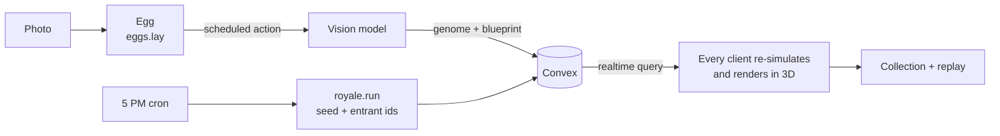

# Snappymon

Snap a photo of anything and you get an egg. At 5 PM Pacific every egg hatches live in a 3D arena and the monsters fight a free-for-all royale. Afterwards your monster lives in your collection and the fight stays as a replay.

- **Live:** https://snappymon.com (web export of the same Expo app)
- **Build log:** [hackathon.md](hackathon.md)

Built at the YC Consumer Mobile Hackathon on 2026-11-15.

## Rules

- One free egg per royale.
- A second egg only as a Golden Egg for $1, paid through Whop. The Whop checkout is still in progress (see below).
- An egg laid after 5 PM waits for the next day's royale.

## How it works

1. **Photo to egg.** The app uploads the photo to Convex file storage and calls `eggs.lay`. You get an egg right away ([convex/eggs.ts](convex/eggs.ts)).
2. **Hidden monster.** In the background a Convex action sends the photo to an OpenAI vision model (`gpt-6.1-sol`, falling back to `gpt-6-luna`). The model returns a strict JSON genome: name, element, two attacks, and a low-poly blueprint of the object built from 8 to 24 primitives (boxes, spheres, cylinders, wheels and so on) ([monster-kit/genome-spec.js](monster-kit/genome-spec.js)). The monster stays hidden inside the egg.
3. **Hatch and royale at 5 PM.** A Convex cron runs the royale at 5 PM Pacific ([convex/crons.ts](convex/crons.ts)). The server runs the deterministic simulation ([monster-kit/royale-sim.js](monster-kit/royale-sim.js)) and stores only the seed, the entrant ids and the result ([convex/royale.ts](convex/royale.ts)). Every client re-simulates the same fight from seed + entrants and draws it in 3D ([monster-kit/arena.js](monster-kit/arena.js)), so all phones and the `/tv` projector show the same fight. Above 20 entrants there are heats of 16 and a final; below 8, wild house monsters fill the arena.
4. **Collection and replay.** After the royale the monster shows up in your collection, and the Arena tab shows your placement and replays your heat or the final.



## Stack

- **Expo SDK 58** with Expo Router, for iOS, Android and web from one codebase.
- **Expo DOM components** (`'use dom'`) run **three.js** inside the native app for the monsters and the arena ([components/MonsterView.tsx](components/MonsterView.tsx), [components/ArenaView.tsx](components/ArenaView.tsx), [monster-kit/](monster-kit/)).
- **Convex** for the database, file storage, server functions, scheduling and crons ([convex/](convex/)).
- **Vercel** hosts the web export at snappymon.com ([scripts/deploy-web.sh](scripts/deploy-web.sh)). Screen designs were made in Paper ([design/](design/)).

## Built with the hackathon stack

**Capy.** Each feature was built in its own Capy thread, which opened the pull request: #1 Expo + Convex scaffold (MONS-1), #2 photo catch and hatching (MONS-2), #3 first docs (MONS-6), #4 sticker-sheet design pass (MONS-4), #5 Arena tab, replays and `/tv` (MONS-3), #7 egg-first flow (MONS-7), #8 Revyl config (MONS-5), #6 Keiki back channel (MONS-8), the Whop Golden Egg work (MONS-9) and this docs PR (MONS-10). Several threads ran at the same time on separate machines. Commits on `main` that did not come through a pull request (monster-kit, most of the Convex backend, the deploy script, the design handoff) were written with Claude Code.

**Revyl.** Capy threads built Release iOS simulator apps on Revyl and ran them on a cloud iPhone to check #1, #2 and #5 (see the verification sections of those PRs). [#8](https://github.com/aydamdonelly/monster-arena/pull/8) adds `.revyl/config.yaml` with a pull-request build profile and turns on proof of changes for every PR, with a rule that test players use a "QA" name. #8 is open.

**Convex.** The database (players, monsters/eggs, royales, events, counters), file storage for the photos, and the scheduled monster generation: `eggs.generate` runs as a scheduled action and retries up to 8 times with growing waits, and a cron every 3 minutes restarts stuck eggs. A second cron starts the royale at 5 PM Pacific. The analytics page (`/analytics`) reads the key-protected `stats.overview` query ([convex/stats.ts](convex/stats.ts)). HTTP webhooks (`convex/http.ts`) for Keiki and Whop are in the open PRs, not on `main` yet.

**Whop.** The Golden Egg ($1, a second egg for the same royale) is paid through a Whop checkout: a Convex action creates the checkout and a `/whop` webhook credits the egg. The credit logic is on `main` (`convex/golden.ts`); the checkout and webhook are on the `whop-golden-egg` branch and still in progress. Until they land, the buy button says the egg shop opens soon.

**Keiki.** iMessage is the back channel: the egg screen has "Text me when it hatches", which opens Messages with a link code to Keiki's shared number. Keiki tool webhooks link the phone to the player, and Convex functions send a royale reminder and, afterwards, each player's placement with a replay link. This is [#6](https://github.com/aydamdonelly/monster-arena/pull/6), still open.

## Run locally

```bash
npm install
npx convex dev    # creates or links a Convex deployment and writes .env.local
npx expo start
```

Environment variables (names only):

- App: `EXPO_PUBLIC_CONVEX_URL` (required), `EXPO_PUBLIC_WEB_URL` (optional, base URL for share links)
- Convex: `OPENAI_API_KEY` (monster generation), `ADMIN_KEY` (admin page, starting a royale), `STATS_KEY` (analytics page)
- Web deploy only: `VERCEL_ORG_ID`, `VERCEL_PROJECT_ID`
