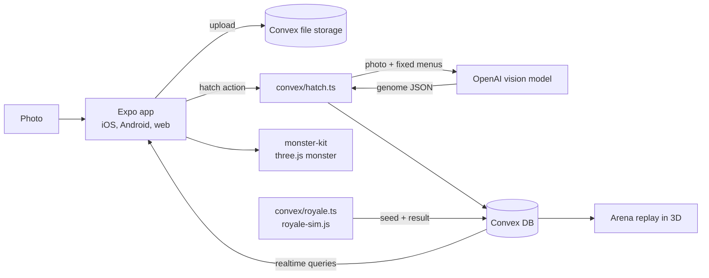

# Snappymon

Take a photo of any real object, it hatches into your own low-poly 3D monster with two unique attacks, and all of today's monsters fight it out in a battle royale.

- **Live:** https://snappymon.com (web export of the same Expo app)
- **Demo video:** _TODO: link coming soon_
- **Build log:** [hackathon.md](hackathon.md)

Built at the YC Consumer Mobile Hackathon, 2026-11-15.

## How it works

1. **Photo.** The app uploads the photo to Convex file storage.
2. **Genome.** A Convex action ([convex/hatch.ts](convex/hatch.ts)) asks an OpenAI vision model for a genome. The model can only pick from fixed menus (body shape, proportions, parts, element, two attacks), defined as a strict JSON schema in [monster-kit/genome-spec.js](monster-kit/genome-spec.js). It also returns the object's own colors from the photo.
3. **Monster.** [monster-kit](monster-kit/) builds the monster procedurally in three.js from that genome and those colors. In the app it renders through an Expo DOM component ([components/MonsterView.tsx](components/MonsterView.tsx)).
4. **Royale.** The fight ([monster-kit/royale-sim.js](monster-kit/royale-sim.js)) is deterministic. The server ([convex/royale.ts](convex/royale.ts)) computes the result and stores the seed, and the arena replays the same seeded fight in 3D ([monster-kit/arena.js](monster-kit/arena.js)).



## Built with

- **[Capy](https://capy.ai)** built the app in these pull requests, each opened from a Capy thread:
  - [#1](https://github.com/aydamdonelly/monster-arena/pull/1) Expo + Convex app scaffold with 3D Catch/Arena/Collection tabs
  - [#2](https://github.com/aydamdonelly/monster-arena/pull/2) Snappymon: photo catch, hatching moment, onboarding, collection
- **Revyl**: Capy's pull requests were built and checked on a Revyl cloud iPhone (see the "Verified" sections of #1 and #2). Proof of changes on Revyl is being enabled in a parallel pull request.
- **[Convex](https://convex.dev)**: schema with indexes ([convex/schema.ts](convex/schema.ts)), the hatch action, the royale, realtime queries (`useQuery` in the Arena, Collection and monster pages) and file storage for the photos.
- **[Expo](https://expo.dev) SDK 58** with Expo Router, and Expo DOM components to run three.js inside the native app.
- **[three.js](https://threejs.org)** for the procedural low-poly monsters and the arena.
- **[OpenAI](https://openai.com)**: a vision model through the Responses API with a strict JSON schema turns the photo into a genome.
- **[Vercel](https://vercel.com)** hosts the web export at snappymon.com ([scripts/deploy-web.sh](scripts/deploy-web.sh)).
- **[Paper](https://paper.design)**: the screen designs in [design/](design/).
- **[Claude Code](https://claude.com/claude-code)** for local orchestration. The commits on `main` that did not come from a Capy pull request (monster-kit, the hatch and royale backend, the deploy script, the design handoff) were written with Claude Code.

## Run locally

```bash
npm install
npx convex dev    # creates or links a Convex deployment and writes .env.local
npx expo start
```

Environment variables (names only):

- App: `EXPO_PUBLIC_CONVEX_URL` (required), `EXPO_PUBLIC_WEB_URL` (optional, base URL for share links)
- Convex deployment: `OPENAI_API_KEY` (for hatching), `ADMIN_KEY` (starting a royale)
- Web deploy only: `VERCEL_ORG_ID`, `VERCEL_PROJECT_ID`
